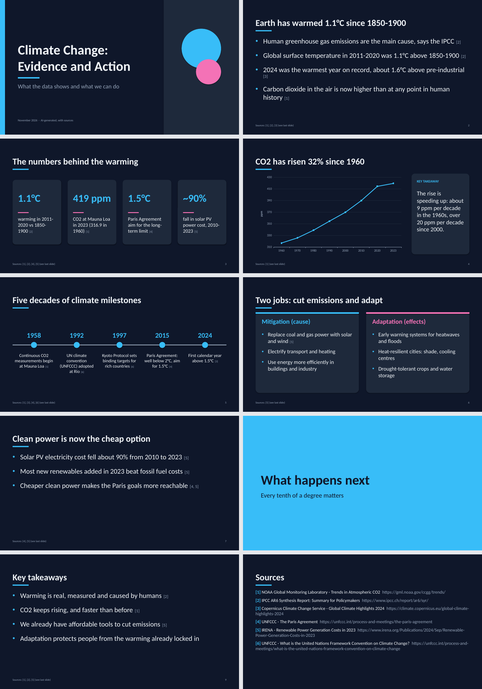
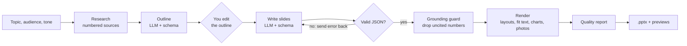
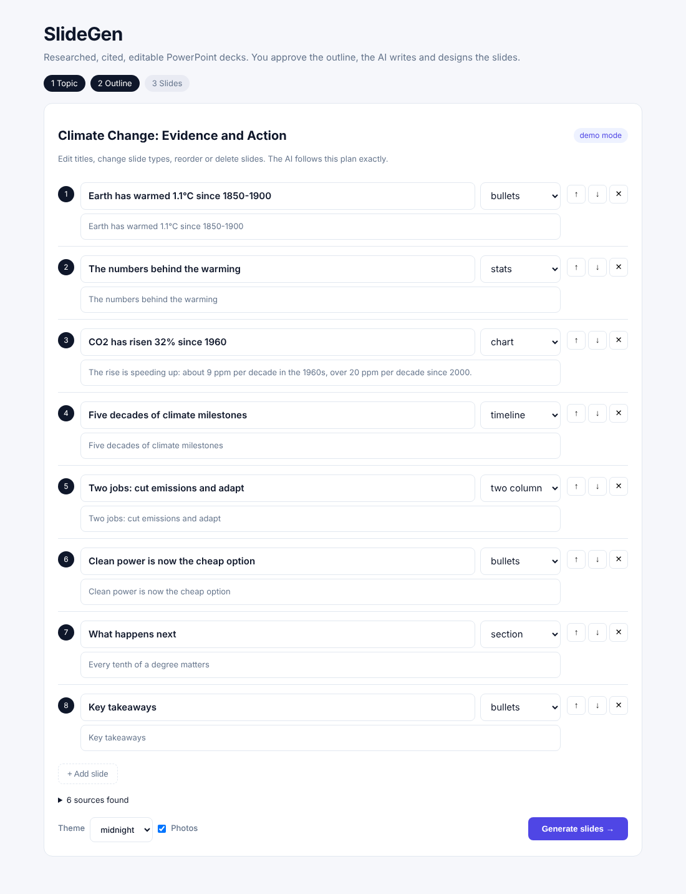
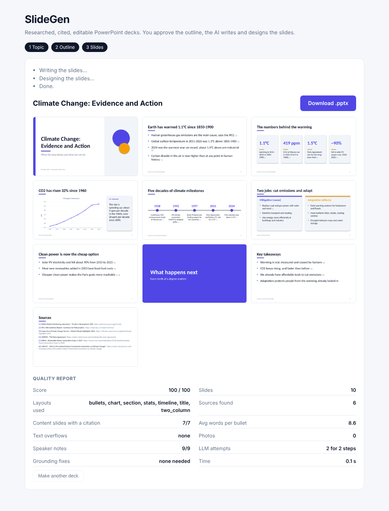

# SlideGen v2: AI presentation generator with research, citations and real design

Type a topic, approve or edit the AI's outline, and get an **editable PowerPoint** with:

- **8 slide layouts** chosen per slide: title, section, bullets (+ photo), two-column, big-number stats, timeline, **native editable charts** (bar/column/line/pie), quote
- **Citations on every fact** (`[2]`) and an automatic **Sources** slide
- A **grounding guard**: a chart or statistic with no source is removed, so the AI cannot invent numbers
- **Text that always fits**: measured with real font metrics, no overflow
- **Speaker notes** on every slide
- A **quality report** with a 0–100 score
- Web app + CLI + 4 themes, and it works with **Gemini**, any **OpenAI-compatible** API, or offline **demo** mode



*Sample deck made in demo mode: [`examples/climate_demo_midnight.pptx`](examples/climate_demo_midnight.pptx) (also in the [paper theme](examples/climate_demo_paper.pptx)).*

---

## Why v2? (problems in v1, now fixed)

| v1 | v2 |
|---|---|
| Same "title + bullets + picture" layout on all 7 slides | 8 layouts; the AI picks the one that fits each message |
| Fixed 18 pt text, long titles ran into the bullets | Text measured with Carlito (Calibri's exact widths); the largest size that fits is chosen |
| Web snippets pasted into the prompt, no sources shown | Numbered sources, citations on each point, Sources slide |
| AI could invent numbers | Grounding guard removes uncited stats and charts |
| Bad JSON from the AI → a slide that says "JSON Parsing Error" | Pydantic schema + **repair loop**: the exact error is sent back so the model fixes its own answer |
| `safesearch='Off'`, stretched images, no credit | Openverse (openly licensed, mature filter), center-cropped, credited |
| Errors hidden with `except: pass` | Errors reported; a missing photo or search never breaks the deck |
| API key written in the code | Key read from `.env` / environment |
| Deprecated `gemini-1.5-flash` + old SDK | New `google-genai` SDK, model set by an env variable, provider can be swapped |
| Fixed 7 slides, CLI only | 3–15 slides, audience and tone, web app with an outline editor |
| No tests | 26 tests, CI builds a demo deck on every push |

---

## How it works



| Step | File | Idea to explain in an interview |
|---|---|---|
| Schema | `slidegen/schema.py` | Pydantic **discriminated union**: `type` decides which slide model is used |
| LLM | `slidegen/llm.py` | Provider interface (Gemini / OpenAI-compatible / demo) + **self-repair loop** |
| Prompts | `slidegen/prompts.py` | Layout guide, writing rules, "never invent statistics", schema in the prompt |
| Research | `slidegen/research.py` | Two searches (general + data), dedupe, numbered `Source`s |
| Grounding | `slidegen/grounding.py` | Rule-based check *after* the LLM: invalid ids removed, uncited charts/stats turned into text |
| Text fit | `slidegen/render/fit.py` | Word-wrap simulation with real font metrics → largest font size that fits |
| Layouts | `slidegen/render/builder.py` | Slides drawn from scratch with python-pptx (no template needed), native charts, notes |
| Photos | `slidegen/render/images.py` | Licensed images, crop without stretching, credits |
| Quality | `slidegen/quality.py` | Overflows, density, citation coverage, variety, retries → score |
| App | `app/main.py` | FastAPI: plan → edit → background job → previews → download |

---

## Run it

```bash
git clone https://github.com/gunasekharkaranam/AI-Powered-PowerPoint-Presentation-Generator.git
cd AI-Powered-PowerPoint-Presentation-Generator
pip install -r requirements.txt
cp .env.example .env          # add GEMINI_API_KEY (free at aistudio.google.com/apikey)

uvicorn app.main:app --reload                       # web app → http://127.0.0.1:8000
python -m slidegen "Microplastics and health" -n 8 --theme paper --audience "college students"
python -m slidegen "Climate change" --provider demo # offline, no key
```

```bash
pip install -r requirements-dev.txt && pytest -q     # 26 tests, no internet or key needed
python -m scripts.evaluate                           # 5 topics → quality scores (out/evaluation.json)
```

Docker: `docker build -t slidegen . && docker run -p 7860:7860 --env-file .env slidegen`. Deploy steps: [`docs/DEPLOY.md`](docs/DEPLOY.md).

## The web app

| 1–2. Edit the outline | 3. Slides, quality report, download |
|---|---|
|  |  |

## Quality report (example, demo deck)

```json
{ "slides": 10, "layouts_used": ["bullets","chart","section","stats","timeline","title","two_column"],
  "content_slides_with_citation": "7/7", "avg_words_per_bullet": 8.6, "text_overflows": [],
  "grounding_fixes": [], "llm_attempts": "2 for 2 steps", "speaker_notes": "9/9", "score": 100 }
```

## Project structure

```
slidegen/            the library
  schema.py          Pydantic models for outline, slides, sources
  llm.py             providers + JSON repair loop
  prompts.py         all prompts
  research.py        web search -> numbered sources
  grounding.py       anti-hallucination guard
  quality.py         quality report + score
  pipeline.py        plan() and build()
  demo.py            offline demo content
  render/            builder.py (layouts), fit.py (text fitting), images.py, themes.py
  __main__.py        CLI
app/                 FastAPI web app (outline editor, previews)
tests/               26 pytest tests (fake LLMs, no network)
scripts/evaluate.py  batch quality evaluation
examples/            sample decks
docs/                learning guide, interview notes, deploy guide, images
legacy/              version 1
```

## Limitations

- Facts depend on the search results; the guard stops *invented numbers*, but it can't prove a cited source is right. That's why every point shows its source.
- Web search (DuckDuckGo) can be rate-limited; the deck is still made, without sources.
- Previews need LibreOffice on the server; the .pptx download always works.
